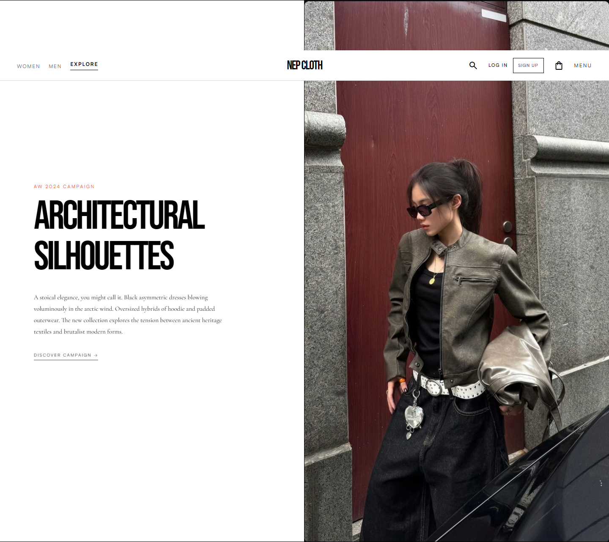

# NEP-CLOTH ✦ High-End Editorial E-Commerce

<p align="center">
  
</p>

<p align="center">
  <strong>A modern, editorial-grade streetwear & contemporary apparel e-commerce platform crafted for Nepal.</strong>
</p>

<p align="center">
  
  
  
  
  
  
  
  
</p>

---

## 📖 Overview

**NEP-CLOTH** marries high-fashion editorial aesthetics with a robust full-stack e-commerce architecture. Built with minimalist Scandinavian and brutalist street fashion design principles, it delivers an ultra-smooth customer shopping journey paired with an enterprise-ready administrative back-office.

---

## ✨ Key Features

### 🛍️ Customer Experience
- **Editorial Aesthetic & Lookbooks**: Full-bleed hero visuals, curated collections (*Men*, *Women*, and *Explore*), and fluid micro-interactions powered by GSAP.
- **Dynamic Catalog & Filtering**: Seamless filtering across product categories (*Tops*, *Outerwear*, *Bottoms*, *Footwear*, *Accessories*) with responsive grid layouts.
- **Interactive Product Detail Pages**:
  - Multi-angle image viewing (product & on-model showcases).
  - Dynamic size & color variant selector with live stock indicators.
  - Related product suggestions.
- **Cart & Frictionless Checkout**:
  - Slide-out quick cart drawer and dedicated Cart page.
  - Cash on Delivery (COD) tailored for domestic delivery across Nepal.
  - Structured address, city, and phone number validation.
  - Human-friendly order number generation (`NEP-XXXXXX`).
- **Order Lifecycle & Tracking**:
  - Detailed order tracking with full status audit trails (`pending` → `confirmed` → `shipped` → `delivered` → `cancelled`).
  - Order history saved to customer profile.
- **Verified Review & Community System**:
  - Star ratings, user feedback, verified-buyer tags.
  - Report abuse / flag moderation for inappropriate content.
  - Official admin response threads.

### 🛡️ Back-Office Admin Portal
- **Protected Role-Based Access Control**: Strict `admin` role authorization guarded on both frontend routes and backend middleware.
- **Business Performance Analytics**: Revenue charts, order volume metrics, average order value, and category breakdowns via Recharts.
- **Product Catalog Management**:
  - Full CRUD for products with automated URL slug generation.
  - Multi-variant management (sizes, colorways, inventory stock).
  - Direct image uploads to Supabase Storage via Multer with MIME/magic-byte verification.
- **Inventory Control**: Live stock adjustments and low-stock alerts.
- **Order Fulfillment Pipeline**: Audit trail status transitions with change records.
- **Review Moderation Hub**: Content approval, filtering hidden reviews, addressing flagged submissions, and replying to customer feedback.

---

## 🛠️ Tech Stack

| Layer | Technologies |
|---|---|
| **Frontend** | React 19, Vite 8, Tailwind CSS v4 (`@tailwindcss/vite`), GSAP, React Router v7, Lucide Icons, Recharts |
| **Backend API** | Node.js, Express 5, TypeScript, Zod, Helmet, CORS, Express Rate Limit, Multer |
| **Database & ORM** | PostgreSQL, Prisma ORM 6 |
| **Authentication & Storage** | Supabase Auth (JWT verification & profile sync), Supabase Storage |

---

## 📂 Project Structure

```text
NEP-CLOTH/
├── Backend/                      # Express 5 + TypeScript + Prisma API
│   ├── prisma/
│   │   ├── schema.prisma         # Database schema (Products, Variants, Orders, Reviews)
│   │   ├── seed.ts               # Initial product catalog seed script
│   │   └── seedAccessories.ts    # Extended accessories seed script
│   ├── src/
│   │   ├── lib/                  # Prisma client, Supabase config, storage helpers
│   │   ├── middleware/           # Auth (requireAuth, requireAdmin), error handler
│   │   ├── routes/               # API routes (products, orders, reviews, admin, auth)
│   │   ├── app.ts                # Express app setup & security middlewares
│   │   └── index.ts              # Server entry point (Port 4000)
│   ├── .env.example              # Backend environment template
│   ├── package.json
│   └── tsconfig.json
│
├── Frontend/                     # React 19 + Vite + Tailwind CSS v4 Client
│   ├── public/                   # Static assets & public images
│   ├── src/
│   │   ├── assets/               # Branding assets
│   │   ├── components/           # Navbar, Footer, ProductGrid, CartDrawer, etc.
│   │   ├── context/              # CartContext, AuthContext
│   │   ├── pages/                # Customer pages (Home, Men, Women, Product, Checkout, Orders)
│   │   │   └── admin/            # Admin portal (Dashboard, Products, Orders, Reviews, Inventory)
│   │   ├── App.jsx               # Client router & layout
│   │   └── main.jsx              # Entry point
│   ├── .env.example              # Frontend environment template
│   ├── package.json
│   └── vite.config.js            # Vite configuration & dev proxy (/api -> :4000)
│
├── .gitignore                    # Monorepo git ignore rules
├── home-last-editorial.png       # Editorial preview asset
└── README.md                     # Project documentation
```

---

## 🚀 Getting Started

### Prerequisites

Ensure you have the following installed on your machine:
- [Node.js](https://nodejs.org/) (v18.0.0 or higher recommended)
- [npm](https://www.npmjs.com/) (bundled with Node)
- A [Supabase](https://supabase.com/) project (for PostgreSQL Database, Auth, and Storage) or a local PostgreSQL instance.

---

### 1. Clone the Repository

```bash
git clone https://github.com/<your-username>/NEP-CLOTH.git
cd NEP-CLOTH
```

---

### 2. Backend Setup

1. **Navigate to the Backend directory and install dependencies**:
   ```bash
   cd Backend
   npm install
   ```

2. **Configure environment variables**:
   Create a `.env` file inside `Backend/` based on `.env.example`:
   ```bash
   cp .env.example .env
   ```

   Fill in the required values:
   ```env
   DATABASE_URL="postgresql://postgres:[PASSWORD]@[HOST]:[PORT]/[DATABASE]"
   SUPABASE_URL="https://[PROJECT-REF].supabase.co"
   SUPABASE_SECRET_KEY="your-supabase-service-role-secret-key"
   FRONTEND_ORIGIN="http://localhost:5173"
   PORT=4000
   ```

3. **Synchronize database schema and seed data**:
   ```bash
   # Push schema to database
   npx prisma db push

   # Seed initial product catalog
   npm run seed

   # (Optional) Seed additional accessories
   npm run seed:accessories
   ```

4. **Start the backend development server**:
   ```bash
   npm run dev
   ```
   The backend will run on `http://localhost:4000`.

---

### 3. Frontend Setup

1. **Open a new terminal, navigate to the Frontend directory, and install dependencies**:
   ```bash
   cd Frontend
   npm install
   ```

2. **Configure environment variables**:
   Create a `.env` file inside `Frontend/` based on `.env.example`:
   ```bash
   cp .env.example .env
   ```

   Fill in your frontend configuration:
   ```env
   # Use /api with the Vite dev proxy to forward calls to http://localhost:4000
   VITE_API_URL=/api
   VITE_SUPABASE_URL="https://[PROJECT-REF].supabase.co"
   VITE_SUPABASE_PUBLISHABLE_KEY="your-supabase-anon-key"
   ```

3. **Start the frontend development server**:
   ```bash
   npm run dev
   ```
   Open your browser and navigate to `http://localhost:5173`.

---

## 🔐 Environment Variables Summary

### `Backend/.env`
| Variable | Description |
|---|---|
| `DATABASE_URL` | PostgreSQL connection string (Prisma pooled or direct URL) |
| `SUPABASE_URL` | Supabase project URL |
| `SUPABASE_SECRET_KEY` | Supabase Service Role key (used for server-side token validation & uploads) |
| `FRONTEND_ORIGIN` | Allowed CORS origin (e.g., `http://localhost:5173`) |
| `PORT` | Port for Express server (default: `4000`) |

### `Frontend/.env`
| Variable | Description |
|---|---|
| `VITE_API_URL` | API endpoint prefix (`/api` for dev proxy, or full URL in production) |
| `VITE_SUPABASE_URL` | Supabase project URL |
| `VITE_SUPABASE_PUBLISHABLE_KEY` | Supabase Anon/Public API Key |

---

## 📡 API Overview

| Method | Endpoint | Access | Description |
|---|---|---|---|
| `GET` | `/health` | Public | Service health status check |
| `GET` | `/products` | Public | List products (with category, section, search, & pagination) |
| `GET` | `/products/:slug` | Public | Fetch product details with active variants and reviews |
| `POST` | `/orders` | Authenticated | Place an order (validates stock & calculates total in paisa) |
| `GET` | `/orders/my` | Authenticated | Fetch orders placed by the current user |
| `GET` | `/orders/:id` | Authenticated | Fetch single order details with status history |
| `GET` | `/products/:productId/reviews` | Public | List published reviews for a product |
| `POST` | `/products/:productId/reviews` | Authenticated | Submit a product review |
| `GET` | `/admin/stats` | Admin | Aggregate dashboard sales & performance stats |
| `GET` | `/admin/orders` | Admin | Manage customer orders pipeline |
| `PATCH`| `/admin/orders/:id/status` | Admin | Transition order status with audit logging |
| `POST` | `/admin/products` | Admin | Create product with variants |
| `POST` | `/admin/upload` | Admin | Upload product images to Supabase storage |
| `GET` | `/admin/reviews` | Admin | Moderate, approve, or hide customer reviews |

*Currency Note: All prices and monetary amounts in the database are stored as integer **paisa** (`NPR 1,000 = 100000 paisa`) to prevent floating-point rounding issues.*

---

## 🛡️ Security & Reliability

- **Secret Protection**: All sensitive tokens and credentials are excluded from source control via `.gitignore`.
- **Validation**: Strict schema validation on inputs using `zod`.
- **DDoS / Abuse Mitigation**: Rate limiting enabled via `express-rate-limit` across sensitive admin & API routes.
- **HTTP Hardening**: Secure headers set up via `helmet`.
- **CORS Protection**: Access strictly restricted to configured frontend origins.

---

## 📄 License

This project is licensed under the [ISC License](LICENSE).
